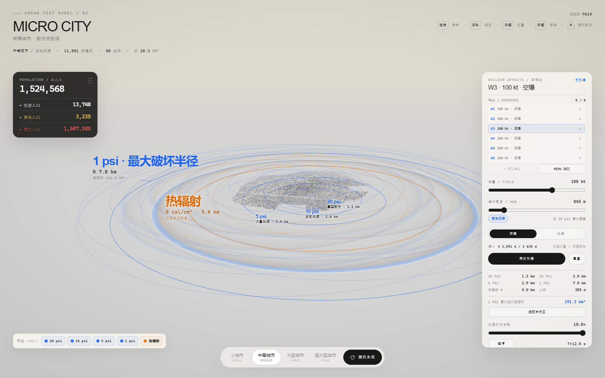

# Micro City — Nuclear Effects Testbed

A browser-based nuclear-effects visualization built on a white miniature city.
It is an educational / visual prototype, not a real-world prediction tool.



## Features

- Four city scales with procedurally generated buildings and population.
- Single or multi-warhead scenarios (up to 6 on desktop, 3 on mobile).
- Per-warhead yield, height of burst (HOB), airburst / groundburst settings.
- 20 / 10 / 5 / 1 psi overpressure rings and an 8 cal/cm² thermal ring.
- Shockwave-driven building damage and one-time casualty allocation.
- Per-ring label switches; only the selected warhead shows its labels.
- MIRV array button that fills the current warhead limit in a ring formation.
- Groundburst craters with ejecta debris and scorch decals.
- Time scale, pause, reset, and camera fitting for all warheads.

## Run

Open `index.html` directly in a modern browser, or serve the folder:

```bash
python -m http.server 8000
```

Then visit `http://localhost:8000`.

There is no build step. Three.js is loaded from jsDelivr via an import map.

## Controls

- Drag: rotate
- Wheel: zoom
- Left click empty ground: add a warhead (or move the selected warhead once at the limit)
- Left click a marker: select that warhead
- Right click a marker: remove it
- Right click empty ground: remove the last placed warhead
- Right panel: warhead list, per-warhead settings, yield / HOB / burst type
- MIRV 阵列: fills the current limit with a circular formation
- 引爆全部: detonate all warheads simultaneously
- 标注 LABELS: show / hide each ring label for the selected warhead

## Model notes

- Blast radii use a 1 kt Fletcher / CEX-62.2-style ground-range table, scaled by
  cube root of yield, with height-of-burst interpolation.
- 5 psi is interpolated between the 4 and 6 psi table entries.
- Thermal radii use a Glasstone & Dolan-style 8 cal/cm² range fit.
- Fireball radii use the CEX / NUKEMAP yield scaling.
- Building damage takes the worst state across overlapping warheads.
- Casualty rates use the user-supplied piecewise overpressure table; overlapping
  warheads take the maximum death / injury rate once per building, not additive.
- Craters are visual bowls with a raised rim, scorch decal and ejecta chunks;
  the ground mesh is not actually cut.

## Limitations

- Not a full Kingery–Bulmash / CFD implementation; use only for illustration.
- No early nuclear radiation, fallout, EMP or firestorm.
- No medical clock; injured counts do not progress to death.
- No thermal-burn casualty model.
- No MIRV bus / reentry trajectory; all warheads detonate simultaneously.
- No warhead fratricide.
- Overlapping craters are independent and not boolean-merged.
- The shockwave uses a 500 m/s equivalent visual propagation speed.

## Attribution

- Three.js
- NUKEMAP / Alex Wellerstein for the public blast and thermal curve references
- Glasstone & Dolan, *The Effects of Nuclear Weapons*
- Fletcher et al., CEX-62.2 blast curve fits

This project is not affiliated with NUKEMAP.

## Disclaimer

This is a visualization and educational prototype. It is not suitable for
operational planning, targeting, or real-world casualty estimation.
